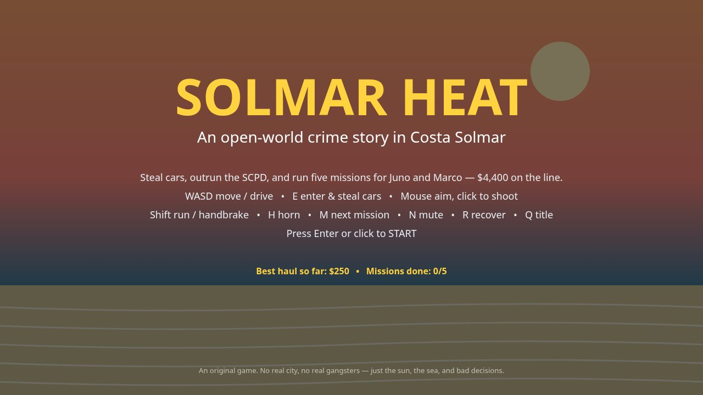

# Solmar Heat — an open-world crime game in Costa Solmar

[](https://make.fun/c/gta6-01)
[](LICENSE)
[](game/index.html)

An original top-down 2D open-world crime game, in the spirit of GTA 6 and
built from scratch for the make.fun **gta6-01** bounty. No Rockstar names,
characters, map or assets: the city of Costa Solmar, its crew Juno and
Marco, and every street, car and song are invented for this game.

## The city

Costa Solmar has seven districts to explore on foot and by car:

- **Solmar Beach** — sand, palms and the ocean at the west edge
- **Marina Bay** — boats, boardwalks and the first meet
- **Harbor Pier** — the pier, the heist car, and the finale
- **Old Town** — Juno's streets, low roofs and tight corners
- **Downtown** — glass towers, fast cars and the ambush
- **Palm Park** — the big lawn where rivals hide
- **North Hills** — the garage at the end of the heist

Traffic cruises the avenues, pedestrians stroll the sidewalks and scatter
when shots ring out, and the SCPD answers a wanted level from 0 to 5 stars
with interceptors that chase and ram, and foot cops who will arrest you if
they catch you standing still.

## The story — five missions, $4,400



1. **First Wheels** (Juno, $400) — steal a car and bring it to Marina Bay.
2. **Beach Run** (Marco, $600) — grab a package on the beach, deliver it Downtown.
3. **Park Cleanup** (Juno, $800) — clear four rivals out of Palm Park on foot.
4. **Harbor Heist** (Marco, $1,000) — steal the marked convertible at the
   pier, shake the heat, deliver it to the North Hills garage.
5. **Solmar Heat** (Juno & Marco, $1,600) — survive the Downtown ambush and
   drive to the pier for the finale.

Street cash, mission payouts and a HUD with health, money, wanted stars, a
clock, the district name, the current objective, a speedometer and a
circular minimap. Progress autosaves to localStorage; the title screen
offers to continue.

## Controls

| Key | Action |
| --- | --- |
| WASD / arrows | Move on foot, drive the car |
| Mouse | Aim — click (hold) to shoot |
| E | Get in / steal a car, get out |
| Shift | Run on foot / handbrake while driving |
| H | Horn |
| M | Next mission (skips the current one, unpaid) |
| N | Mute / unmute |
| R | Recover — tow back to the road, full health |
| P / Esc | Pause |
| Q | Back to the title screen |
| Enter / click | Start, continue, respawn |

## Run it

```sh
node serve.ts
# open http://localhost:8080
```

No build step, no dependencies, no network requests: `game/` is plain
static files and everything — art, sound and music — is drawn or
synthesized in code.

Headless smoke test (walk, steal, drive, shoot, mission progress):

```sh
# open http://localhost:8080/?selftest=1 and read window.__selftest
```

Screenshot scenes (also how `screenshots/` was made):

```sh
# http://localhost:8080/?shot=start&seed=7
# http://localhost:8080/?shot=drive&seed=7
# http://localhost:8080/?shot=mission&seed=7
# http://localhost:8080/?shot=chase&seed=7
```

## Hand it in

```sh
mkdir -p out && MAKEFUN_OUTPUT_DIR=out node main.ts
```

`main.ts` copies `game/` and `screenshots/` to the output directory and
writes `dossier.json` with the vendored make.fun library.

## About

Built for [make.fun](https://make.fun) — the gta6-01 bounty. The entry is
the game in `game/`, its screenshots in `screenshots/`, and `main.ts`.
